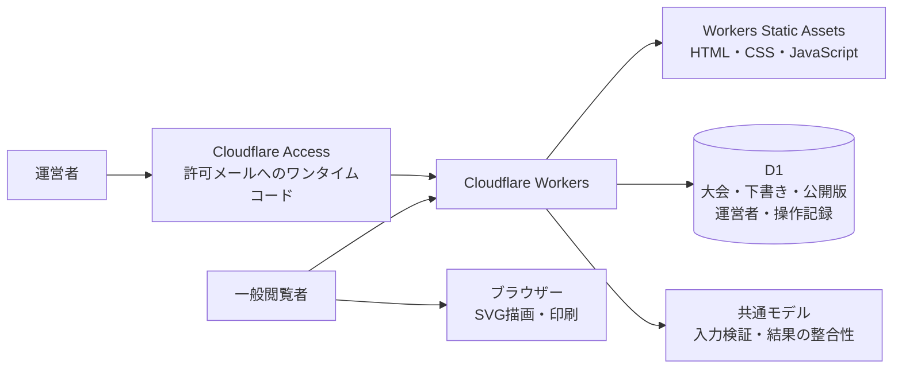

# トーナメント表システム Cloudflare構成設計書

更新日：2026年10月26日

本書はCloudflare WorkersとD1への移行を設計する。[要求分析](要求分析.md)の回答を根拠とし、未回答の項目は提案または未決として示す。テーブルとAPIは実装前の設計案である。

## 1. 構成と責務



WorkerはFetch APIでHTTP要求を処理し、D1バインディング`env.DB`からデータを読み書きする。HTML・CSS・JavaScriptはWorkers Static Assetsへ配置する。静的ファイルの配信とAPIを同じWorkerで提供できる。[Static Assets公式資料](https://developers.cloudflare.com/workers/static-assets/)、[D1バインディング公式資料](https://developers.cloudflare.com/d1/worker-api/d1-database/)

| 現行 | 移行後 |
| --- | --- |
| `server.js`のNode.js HTTPサーバー | Workerの`fetch(request, env, ctx)`とルーティング。 |
| `readFile`・`writeFile`・`rename` | D1リポジトリー。業務データのローカルファイル保存を廃止する。 |
| グローバル変数`state` | リクエストごとにD1から必要な大会・版を取得する。 |
| `saveQueue` | D1の条件付き更新とトランザクション。 |
| `sessions`・`failures` | Accessによるログイン管理。D1の運営者有効状態を毎回検証する。 |
| `src/model.js` | 業務データ検証と、試合情報・変更影響の検証を拡張する。 |
| `src/engine.js` | 2〜64組の手動配置、BYE省略、勝者伝播を維持する。 |
| `/`と`/admin`の1大会画面 | 大会別閲覧、管理大会一覧・大会別編集へ拡張する。一般向け大会一覧は作らない。 |

運用データの正本はD1に置く。画面コードは静的アセット、認証設定はAccess、構成値と秘密情報はWorkersの設定・Secretsで管理する。SVGの座標や印刷結果は保存済みの大会内容から導出する。PDFファイルの恒久保管は要求がないため初期案に含めない。

## 2. 利用者と認証

確定した役割は管理者、編集者、一般閲覧者。運営者は1〜5人を想定する。管理者と編集者は全大会を編集・公開できる。運営者の追加・停止は管理者だけが行う。一般閲覧者が取得できるのは公開用データに限る。

Accessでは許可されたメールアドレスへのワンタイムコードを使用する。[Accessのワンタイムコード認証](https://developers.cloudflare.com/cloudflare-one/integrations/identity-providers/one-time-pin/)

Workerは`Cf-Access-Jwt-Assertion`の署名、issuer、audience、有効期限を検証する。ヘッダーの有無やメールアドレス文字列だけで認証を通さない。検証した識別情報をD1の運営者に対応付け、有効状態と権限を確認する。[WorkerでのJWT検証](https://developers.cloudflare.com/cloudflare-one/access-controls/applications/http-apps/authorization-cookie/validating-json/)

| 操作 | 管理者 | 編集者 | 一般閲覧者 |
| --- | --- | --- | --- |
| 公開された大会の閲覧・印刷 | 可 | 可 | 可 |
| 全大会の下書き閲覧・作成・編集 | 可 | 可 | 不可 |
| 公開・公開停止 | 可 | 可 | 不可 |
| 運営者の追加・停止・権限変更 | 可 | 不可 | 不可 |
| DBバックアップ・復旧 | Cloudflareの運用権限を持つ管理者 | 不可 | 不可 |

初期版では運営者管理画面を作らず、Accessの管理画面と専用の管理コマンドで設定する。招待時はD1に対象メールと役割を登録した後、Accessの許可メールへ追加する。停止時はまずD1を無効にしてAPIへのアクセスを拒否し、Accessの許可も外す。両方の設定完了を手順で確認する。管理コマンドは初期管理者の登録、追加、停止、権限変更を扱い、最後の有効な管理者の停止を拒否する案とする。

`/admin`、`/admin/*`、`/api/admin/*`を保護する。Worker側の認可は経路にかかわらず適用し、`workers.dev`やプレビューURLなど別経路からも迂回できないようにする。管理APIは`Cache-Control: no-store`とし、状態変更では許可Origin、JSONのContent-Type、CSRF対策を検証する。Access用ポリシーと運用者向けCloudflareアカウントの権限は別管理とする。

## 3. 保存単位とD1モデル

### 3.1 保存方式の提案

大会一覧、運営者、公開状態は列として管理し、大会内容は版ごとのJSONをD1のTEXT列へ保存する。ファイルを使わず、DB内で大会の一貫した状態を保持する。

既存アプリは大会全体を検証・保存し、参加者と組合せから試合を導出する。この境界を維持すると、移行時にBYEや結果訂正の規則を変えずに下書きと公開版を分離できる。現在の要求に参加者横断検索や試合単位の同時更新はないため、初期案では参加者・枠・試合を個別テーブルに分けない。これらが必要になった場合は正規化した表へ移行する。複数形式を正本にして二重更新する方式は避ける。

| テーブル | 主な列 | 制約・用途 |
| --- | --- | --- |
| `operators` | `id`, `email`, `access_subject`, `role`, `active`, `created_at`, `updated_at` | メール一意。役割は`admin`か`editor`。本人確認後にAccess subjectを対応付ける。停止済みを認可しない。 |
| `tournaments` | `id`, `slug`, `draft_revision`, `published_revision`, `lock_version`, `created_by`, `created_at`, `updated_at`, `published_at`, `archived_at` | IDとslugは一意。公開版は未公開時NULL。版の参照先は必ず同じ大会に属する。 |
| `tournament_revisions` | `tournament_id`, `revision`, `schema_version`, `document_json`, `mutation_id`, `created_by`, `created_at` | 主キーは大会IDと版番号。JSON妥当性制約。保存済みの内容を直接上書きしない。操作IDは一意。 |
| `audit_events` | `id`, `tournament_id`, `actor_id`, `action`, `revision`, `mutation_id`, `request_hash`, `result_lock_version`, `created_at` | 操作IDは一意。作成・保存・公開・公開停止・運営者変更を記録する案。再送時は要求のハッシュを照合する。本文・認証トークンをログへ複製しない。 |

IDはUUID、slugは暗号学的乱数で128bit以上の推測しにくい識別子とする案。大会名や連番をURLにしない。大会名を変えてもURLを変えない。slugの手動編集は初期案に含めない。一般向け大会一覧、一覧API、サイトマップを作らない。`/`は大会情報を含まない案内とする。

大会画面と応答には検索エンジンへの非掲載指定を付け、不要な外部リソースを参照しない。URL共有には閲覧者の本人確認を設けず、転送されたURLからも閲覧できる。厳密に関係者へ限定する認証付き共有とは区別する。参加者名には大会に応じて団体名・個人名の両方を扱い、公開版とPDFへ掲載する。連絡先や生年月日など、追加の名簿情報は要求に含めない。手動削除と共有URLの変更は未確定とする。

`draft_revision`と`published_revision`には、`tournament_id, revision`の複合参照を設ける。初回作成は版1から始め、同一トランザクション内で大会と初版を作成する。循環する参照の挿入順序と遅延外部キーの扱いは、SQL実装時にD1上で検証する。必要なインデックスはメール、slug、公開大会の列、操作記録の大会IDと作成日時に設ける。

### 3.2 版に保存する業務データ

```json
{
  "title": "秋季大会",
  "date": "2026年11月",
  "notes": "大会全体の注記",
  "participants": [
    {"id": "p_a", "name": "Aチーム"},
    {"id": "p_b", "name": "Bチーム"}
  ],
  "slots": ["p_a", "p_b"],
  "results": {"R1-M1": "p_a"},
  "matchDetails": {
    "R1-M1": {
      "scoreA": 3,
      "scoreB": 2,
      "scheduledAt": "2026-11-01T09:00:00+09:00",
      "venue": "第1会場",
      "notes": ""
    }
  },
  "layoutSettings": {"slotsPerPage": 16}
}
```

`results`を残すと既存エンジンを継続利用できる。`matchDetails`は実在する試合IDだけを許可し、BYEの試合情報を作らない。得点A/Bはその試合の左右の入力元に対応する。片側未確定の試合でも予定日時と会場を登録できるが、勝者の指定は両者確定後に限る。

業務データには公開フラグやDBの競合制御値を含めない。`schema_version`はJSON構造の版、`revision`は大会内容の保存版、`lock_version`は公開操作も含めた更新の競合制御であり、役割を区別する。公開APIからは運営者、履歴、操作記録などを除いた項目だけを返す。

### 3.3 入力検証の提案

| 項目 | 規則 |
| --- | --- |
| 下書き | 参加者0〜64組、未配置を許す。未完成の組合せに勝者・得点を登録しない。 |
| 公開 | 大会名必須、2〜64組、全参加者を重複なく配置。全試合の日時・会場・結果が埋まっている必要はない。 |
| 名前 | 参加者IDは大会内一意。名前の重複は警告し、IDで区別して保存を許す案。 |
| 文字数 | 大会名100、参加者名100、大会注記1000は現行値を維持する案。会場100、試合注記1000を追加する案。 |
| 得点 | 各側は非負整数またはNULL。両側入力か両側未入力とする案。得点だけでは勝者を決めない。同点・得点なしの勝者選択を許す。 |
| 勝者 | 実際の対戦者のいずれかだけを許可する。得点と選択勝者が矛盾する場合は警告し、注記で事情を記録して保存できる案。 |
| 日時 | 開始日時は任意。画面入力はAsia/Tokyo、保存はタイムゾーンを明示した日時。日付だけ・時刻未定への対応は追加確認事項とする。 |
| 会場・注記 | 任意のテキスト。HTMLを解釈せず、SVG・HTMLで安全に出力する。 |
| 印刷設定 | `slotsPerPage`は8・16・32。保存した設定を公開版にも引き継ぐ案。 |
| JSONサイズ | 現行の256,000文字という制限はそのまま移さず、UTF-8バイト数による上限へ変更する。値は最大ケースを計測して決める。 |

文字数と試合情報の上限は、業務上の要求として未確認のため実装前の提案値とする。

## 4. 保存・公開・競合

### 4.1 利用者の操作

| 操作 | 保存状態 | 一般閲覧への影響 |
| --- | --- | --- |
| 大会作成 | 未公開の初版を作成する。 | 表示しない。 |
| 下書き保存 | 新しい版を作り、編集版の参照先を更新する。 | 公開中の版を維持する。 |
| 公開 | 指定された保存済みの版を検証し、公開版の参照先を更新する。 | 次の取得からその版を表示する。 |
| 公開停止 | 公開版の参照先をNULLにする。 | 次の取得から表を表示しない。 |
| 終了大会の保管 | 編集一覧で終了済みとして整理する案。 | 公開停止とは別に扱い、過去大会を引き続き閲覧できる。 |

公開時には`expectedLockVersion`と`targetRevision`を送り、画面で確認した保存版だけを公開する。別の運営者が先に更新していた場合、知らない版を公開せず409を返す。未保存の編集内容を暗黙に公開しない。

公開停止後も、既に閲覧した内容やダウンロードしたPDFまでは回収できない。Q14の回答に従い、公開範囲は一覧掲載なしのURL共有とする。

### 4.2 同時更新

保存・公開・公開停止のすべてで、大会ごとの`lock_version`を比較して更新する。事前にSELECTしてから無条件UPDATEする方式や、Workerのメモリー内で排他する方式は使わない。競合時は409と最新の版情報を返し、画面の未保存入力を残して再確認を促す。自動上書きはしない。

複数の書き込みはD1の`batch()`でまとめる。バッチ内のSQLが失敗した場合は全体がロールバックされる。[D1 batchの公式仕様](https://developers.cloudflare.com/d1/worker-api/d1-database/)

ただし、条件付き更新が0件でもSQLエラーにはならない。このため、競合した操作で版・操作記録だけが追加されないよう、各書き込みの条件を共通にする。保存では、期待版に一致するときだけ一意な`mutation_id`を持つ新しい版をINSERTし、その版が今回作成された場合だけ編集版の参照と操作記録を更新する案とする。INSERTが0件なら後続も0件とし、競合を返す。DBの一意制約と同時要求テストで検証する。

応答が失われた場合に同じ操作を再送できるよう、クライアント生成の操作IDと要求内容の照合で重複を検出する案とする。古い版番号による409と、すでに成功した操作の再送を区別する。既存の公開版・編集版が参照する版は削除しない。過去大会の最新内容と公開内容は無期限に保持する。不要な中間版と操作記録まで無期限に保存する要求ではないため、初期案は中間版7日、操作記録90日とし、定期整理する。再送の受付期間は24時間とする案。保持期間は運用確認後に確定する。

### 4.3 組合せと結果の訂正

| 変更 | 取り消す内容 | 維持する内容 |
| --- | --- | --- |
| 名前・大会名の変更 | なし。 | 参加者ID、組合せ、結果、試合情報。 |
| ある試合の勝者の変更・取消 | その進出先から決勝までの、対戦者が変わる試合の勝者・得点。 | 他の山の結果。試合日時・会場は維持して確認を促す。 |
| 参加者・枠の変更 | 参加者構成が変わる部分木の勝者・得点。 | 変わらない部分木の結果。 |
| 試合そのものがなくなる変更 | 消滅する試合の勝者・得点・日時・会場・注記。 | 同じ入力元を持つ実在試合の情報。 |
| 得点・日時・会場・注記だけの訂正 | 後続の勝者は取り消さない。 | 既存の勝者と組合せ。 |

現在の`R1-M1`などは位置由来のIDであり、組合せ変更後に同じIDが別の対戦を指す場合がある。試合情報の維持をID一致だけで判断せず、入力元と参加者構成を比較する。同じIDでも別対戦となる注記は消去対象として提示する案とする。

画面に影響する試合と消える項目を表示する。保存APIでも影響を再計算し、要求の版と取り消し確認内容が一致しなければ保存しない。確認画面を通さずに古い結果だけを送っても、不正な結果を残せないようにする。

## 5. APIと画面

APIの名前と細部は提案。管理APIの全要求で認証・認可を行う。

| メソッド・パス | 目的・主要な条件 |
| --- | --- |
| `GET /api/public/tournaments/:slug` | 公開版と公開版番号だけを返す。未公開・停止・存在しない大会は404。 |
| `GET /api/admin/me` | 運営者自身の役割と有効状態。 |
| `GET /api/admin/tournaments` | 全大会の編集一覧。ページ送りを設ける。 |
| `POST /api/admin/tournaments` | 未公開大会を作る。操作IDで再送を処理する。 |
| `GET /api/admin/tournaments/:id` | 編集版、公開版番号、競合制御版を返す。 |
| `PUT /api/admin/tournaments/:id/draft` | 全体保存。`expectedLockVersion`、`mutationId`、本文、結果取消の確認を受け取る。 |
| `POST /api/admin/tournaments/:id/publish` | 指定した保存版を公開する。 |
| `POST /api/admin/tournaments/:id/unpublish` | 公開を停止する。競合制御版も確認する。 |

入力不正は400、認証不足は401、権限不足は403、存在しない対象は404、競合は409、サイズ超過は413、依存先の一時障害は503として区別する案。DBエラーやトークンの詳細は応答へ出さない。

| 画面 | 変更点 |
| --- | --- |
| `/` | 大会情報や一覧を含まない案内。 |
| `/t/:slug` | 指定大会の公開版を表示する。公開日時と版を示す。 |
| `/admin` | 大会一覧、新規作成、下書きと公開状態を表示する。 |
| `/admin/tournaments/:id` | 大会・参加者・組合せ・試合情報を編集する。下書き保存と公開を別ボタンにする。 |

公開画面は初期設定5分で現在の公開版を確認し、「最新に更新」操作も提供する。Q10の当初回答は30秒だったが、追加回答で5分程度まで許容された。ETagは版番号だけでなく大会IDを含める。変更がなければ304を返し、SVGを再描画しない。タブが非表示なら停止し、復帰時に再確認する案。失敗時は最後に取得した表と確認時刻を残し、古い可能性を表示して再試行する。404で公開停止を確認した場合は表を消す。

初期案では公開JSONも`Cache-Control: no-cache`で毎回再検証する。下書きや公開停止の反映を妨げるキャッシュを導入しない。閲覧者数が多い場合は短時間の共有キャッシュを再検討し、公開停止の許容遅延と一緒に決める。

公開停止を開いたままの画面が検知するまで、通常は最大約5分かかる。即時に消す保証は設けない。更新間隔は環境設定で変更できる設計とし、短縮する場合は総要求数を再計算する。

### 5.1 負荷と無料プランの判断

年間10大会、同時閲覧1,000人が10〜30分続く条件で、まず無料プランから開始する案とする。安定稼働を優先し、必要なら有料化する方針は確認済みである。以下は全員が同じ間隔で確認し続ける場合の計算であり、初回読込、手動更新、管理操作、バックアップ、同じアカウントの他サービスを含まない。

| 確認間隔 | 同時1,000人の1時間の要求数 | 10〜30分の定期確認 | 評価 |
| --- | --- | --- | --- |
| 30秒 | 約120,000 | 約20,000〜60,000 | 当初案。無料枠を短時間で消費する。 |
| 5分 | 約12,000 | 約2,000〜6,000 | 採用案。初回読込は別途約1,000要求。 |

Workers Freeは1日100,000要求、CPUは1要求10ms。D1 Freeは1日500万行の読込、10万行の書込、DB単体500MBが上限である。静的アセットをWorkerを経由せず配信する要求は無料・無制限だが、APIの呼出は別に数える。[Workers料金](https://developers.cloudflare.com/workers/platform/pricing/)、[D1料金](https://developers.cloudflare.com/d1/platform/pricing/)、[D1上限](https://developers.cloudflare.com/d1/platform/limits/)、[Static Assetsの料金](https://developers.cloudflare.com/workers/static-assets/billing-and-limitations/)

ETagやD1読込のキャッシュだけではWorkerの要求上限を解消できない。5分更新でも同時1,000人が8時間続けば定期確認だけで約96,000要求になるため、当日全体で確認する。想定日の全要求が無料枠の70%を超える場合や、CPU上限を満たさない場合は、大会前に有料化を検討する運用基準を提案する。無料枠の上限到達後に管理APIだけを確実に動かせるとは扱わない。受入時はJWT検証・モデル検証・D1操作を含むCPU時間も測定する。

負荷試験はローカル・検証環境で短時間に行い、無料枠を浪費する長時間試験を本番で実施しない。運営者1〜5人は、確認時点のZero Trust Freeの50人枠内である。一般閲覧者1,000人にはAccessログインを求めず、この運営者数と分けて扱う。[Cloudflareのプラン](https://www.cloudflare.com/plans/)

## 6. 印刷と試合情報の表示

PDFを印刷画面を経由せず直接ダウンロードすることは確定した。生成はブラウザー内で行い、Workersでのブラウザー起動やPDF生成ジョブは初期案に含めない。生成済みPDFをD1へ保存しない。

既存の`renderTournament()`が返す`scenes`を、SVGとPDFの両方の描画元とする。`pdf-lib`と`@pdf-lib/fontkit`を候補とし、ライブラリとフォントはバージョン・ライセンスを確認して静的アセットへ同梱する。pdf-libはブラウザーでのPDF作成、ベクター描画、独自フォントの埋込を提供する。[pdf-lib公式資料](https://pdf-lib.js.org/)

1. 対象版のJSON、レイアウト設定、日本語フォントを読み込む。
2. 共通レイアウトからページ単位の線・文字・座標を生成する。
3. A4縦の各ページへmmをptに変換し、上原点から下原点へのY座標変換も適用して描画する。
4. 日本語フォントを埋め込み、対応する文字の不足やフォント読込失敗はエラーとして表示する。
5. ページ数と生成完了を確認してPDFのBlobを作り、ダウンロードする。端末の保存UIに応じた案内を表示する。

文字の省略と折返しはSVGとPDFで別々に判定せず、同じフォントの計測結果から共通で決める。現行のSVGレンダラー内の概算幅による省略処理はこの共通処理へ移す。候補フォントはNoto Sans CJK JPとし、配布・埋込のライセンスを同梱する。[Noto CJKの配布資料](https://github.com/notofonts/noto-cjk/blob/main/Sans/README-third_party.md)

既存のA4縦、8・16・32枠でのページ分割を初期案として維持し、得点・日時・会場・注記を画面と印刷へ追加する。現在の余白と行間では情報が収まらない可能性があるため、64組と長い会場・注記を含む実寸で検証する。長文注記を別紙へまとめる案も含め、試作後に判断する。

運営者が下書きを印刷する場合は、下書きであることと保存版を示す案。一般閲覧者の印刷には公開版だけを使用する。公開版と編集中の版を混ぜて印刷しない。

PDF生成開始時点の版を固定し、生成中のポーリング更新を混ぜない。未保存の変更がある運営者には保存を求める案。ファイル名と文書のメタデータに大会名・対象版を含める。PCとスマートフォンで、日本語の文字化け、文字欠け、ページ寸法、ページ順、画面との一致を検証する。ブラウザー印刷も継続して提供する。

## 7. バックアップ、運用、移行

### 7.1 復旧

アプリ内の大会単位の復元UIは作らない。許容する巻き戻りは最大1日前、復旧期限は障害の翌日まで。D1 Time TravelによるDB単位の復旧と、日次のDBエクスポートを用意する。2026年10月26日に確認した公式上限ではTime TravelはFreeが7日、Workers Paidが30日。[D1 Limits](https://developers.cloudflare.com/d1/platform/limits/)

Time Travelで本番DBを直接復旧すると、他大会や運営者を含めてDB全体を巻き戻す。復旧前に現状を退避し、書き込みを停止し、対象時点と影響を確認して実行する。[Time Travelの復旧仕様](https://developers.cloudflare.com/d1/reference/time-travel/)

復旧後は公開版・運営者の状態も検証する。大会単位でのデータ救出が必要な場合は、バックアップを別環境で読み、対象大会を取り出す管理手順を用意する。アプリ内に保持する中間版をバックアップの代わりにしない。

日次の自動エクスポートを基本とし、大会前、重要な更新・構造変更の前後にも退避する。出力は暗号化し、本番DB以外の管理者だけがアクセスできる保存先へ置く。実行失敗を通知し、最後に成功したバックアップが24時間以内であることを確認する。保存先と定期実行の基盤は実装前に決め、バックアップ保持は30日を初期案とする。バックアップのためだけにR2など追加サービスの契約を必須にしない。無料プランのTime Travelが7日であることと、過去大会そのものを無期限に保存することは別の要件として扱う。

復旧訓練では、退避したDBを検証環境で読み込み、大会・公開版・結果・運営者の復元を確認する。記録した障害時点とバックアップ時点の差が24時間以内であり、翌日までに利用を再開できる手順と担当を確保する。バックアップ担当にはCloudflareのアカウント復旧手段も引き継ぐ。

### 7.2 環境と監視

ローカル、検証、本番でD1と設定を分ける。Wrangler設定にWorker、静的アセット、D1バインディング、互換日付を記述する。API経路を必ずWorkerへ渡し、存在しないAPIがHTMLへフォールバックしないようにする。アセット用ディレクトリへ公開対象だけを配置し、リポジトリ全体、DBエクスポート、設計書やSecretsを公開しない。

DBマイグレーションは番号付きSQLで管理する。互換性のある追加を先に適用し、新Workerを検証してから不要列を整理する。WorkerのロールバックだけでDB構造やデータも戻るとは扱わない。

APIエラー率、保存失敗、D1使用量、ポーリング要求数、認証・認可失敗を監視する案。ログへ大会本文、参加者名、JWT、ワンタイムコードを記録しない。無料枠70%を導入前の見積りと日次監視の目安とする案。細部は検証で調整する。

独自ドメインは取得希望があるが未取得。名前・登録費用・取得先は未決とし、購入は別途行う。検証は`workers.dev`で開始でき、独自ドメイン取得後に管理・公開の経路を設定する。認証済み管理経路だけをAccessで保護し、一般閲覧までログイン必須にしない。[WorkersのAccess保護方式](https://developers.cloudflare.com/workers/configuration/cloudflare-access/)

### 7.3 初回導入

Q15の回答により、移行対象の既存JSONは存在しない。取込ツールは初期リリースに含めず、空のD1から開始する。

1. ローカルと検証環境にスキーマを適用し、テストデータで保存・公開・競合を確認する。
2. 本番用D1、Worker、Accessを設定し、管理コマンドで初期管理者を登録する。
3. Accessの許可メールを設定し、未招待・停止済みの拒否と、管理者・編集者の操作を確認する。
4. 最大64組のSVG、日本語PDF、5分更新・手動更新を検証する。
5. ピーク同接1,000人と当日全体の負荷見積りから無料枠での開始条件を確認する。
6. バックアップと復旧訓練を実施し、本番にテストデータを残さず利用を開始する。
7. 独自ドメインを取得する場合は経路とAccessの保護範囲を更新し、別URLからの管理API迂回がないことを再確認する。

現行の共通パスワードとセッションは引き継がない。導入後に問題があれば新しい書き込みを止めてDBを退避し、互換性を確認したWorker版へ戻す。DBだけ・コードだけを無条件に巻き戻す手順にはしない。

## 8. 実装順序と受入条件

| 段階 | 実装内容 | 主な確認 |
| --- | --- | --- |
| 1 | 入力の細部、画面・印刷の試作、API契約を確定する。 | 今回の回答を反映し、未決の技術提案を記録する。 |
| 2 | D1スキーマ、Worker入口、静的配信、Access検証、運営者コマンド。 | 未認証・未招待・停止済みを拒否し、別URLから迂回できない。 |
| 3 | 複数大会、下書き保存、公開・停止、競合制御。 | A公開後にB保存してもAを表示する。同時要求で一方だけが成功する。 |
| 4 | 得点・日時・会場・注記、変更影響の確認、公開ポーリング。 | 訂正対象だけを取り消す。新公開版を約5分で検知し、手動更新でき、下書きは漏れない。 |
| 5 | 直接PDFダウンロード、初回導入、復旧訓練、負荷検証。 | 最大64組の実寸印刷・日本語PDF、同接1,000人、当日合計要求数、バックアップ復旧を確認する。 |

DB保存と公開のテストはWorkersのローカル環境で実行し、検証環境のD1でも確認する。既存のNode.jsサーバーテストだけをD1移行完了の根拠にしない。特に「条件付き更新0件」「バッチ途中失敗」「公開と保存の同時実行」「応答消失後の再送」「停止済み運営者の有効JWT」を受入テストに含める。
