# 大会トーナメントアプリ システム管理者向け運用手順書

更新日：2026年10月26日  
版：0.3・開発中  
対象：Cloudflareを初めて使うシステム管理者

この手順書では、Cloudflareのアカウントを準備し、大会トーナメントアプリをインターネットで利用できるようにするまでを説明します。Cloudflareの利用経験は必要ありません。アプリ名は仮称です。

大会の作成や結果入力は[取扱説明書](取扱説明書.md)を参照してください。本書では、アプリの利用開始前の準備、運営者の追加・停止、バックアップ、困ったときの確認方法を扱います。

本書の改訂では、公式資料と手元のコードを確認しています。Cloudflare上での一連の構築操作、スマートフォンの実機操作、本番データの復旧は実行していません。未検証の復旧作業は開発者と進めます。

各章では、最初に図で全体の関係や作業順序を確認し、その下の手順に沿って操作します。図の下の「図の編集用Mermaidコード」は、説明書を更新する人向けです。

## 1. 最初に、管理者の作業を確認する

### Cloudflareとは

Cloudflareは、インターネット上でアプリを動かしたり、ログインを管理したりするサービスです。このアプリでは、次の機能と管理画面を使います。

| 画面に出てくる名前 | 読み方・意味 | このアプリでの役割 |
| --- | --- | --- |
| Workers | ワーカーズ。アプリを動かす機能。 | 大会の画面を表示し、保存や公開の操作を受け付けます。 |
| D1 | ディーワン。データを保存する機能。 | 大会、参加者、結果、運営者の登録情報を保存します。 |
| Access | アクセス。ログインを管理する機能。 | 許可されたメールアドレスへのワンタイムコードで、運営者本人か確認します。 |
| Zero Trust | ゼロトラスト。Accessなどを設定する管理画面。 | ログイン方法や、利用を許可する人の設定に使います。 |

ワンタイムコードは、ログインのたびにメールで受け取る使い切りのコードです。運営者はCloudflareの管理用アカウントを作らずに、このコードで大会の編集画面へログインできます。[メール認証の公式説明](https://developers.cloudflare.com/cloudflare-one/integrations/identity-providers/one-time-pin/)

### 大会アプリの全体像

運営者はメール認証を通って編集し、閲覧者は共有URLから公開中の大会を見ます。データはCloudflare上のD1に保存します。


<details>
<summary>図の編集用Mermaidコード</summary>

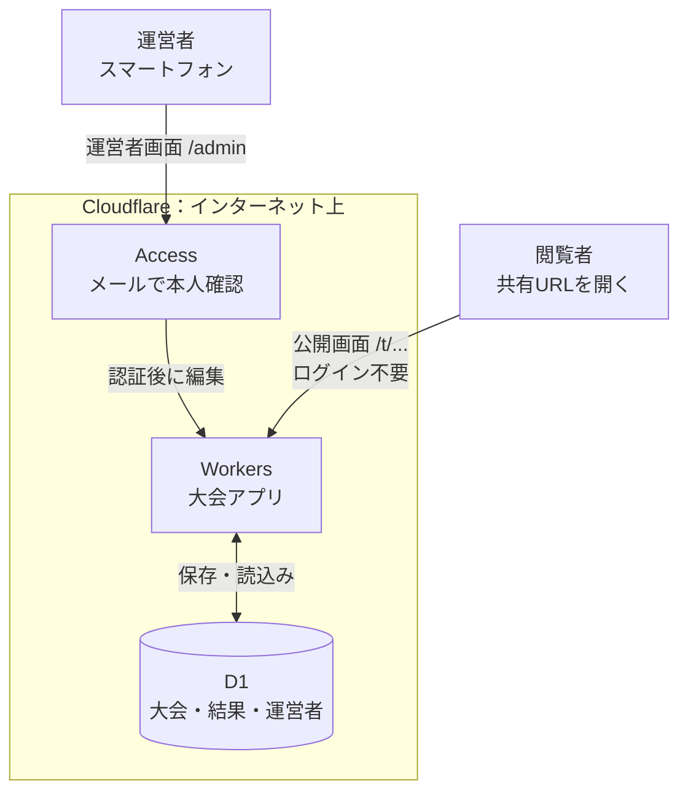

</details>

### 管理者のログインと、運営者のログインの違い

| 開く画面 | 利用する人 | 用途 |
| --- | --- | --- |
| Cloudflareの管理画面 | システム管理者 | アプリの設置、料金の確認、ログイン許可の設定、障害調査。 |
| 大会アプリの運営者画面 | 大会運営者 | 大会の作成、結果入力、保存、公開。URLの末尾は `/admin` です。 |
| 大会アプリの共有画面 | 閲覧者 | 公開された大会を見る画面。大会ごとのURLを使います。 |

大会アプリには `admin` と `editor` という役割があります。どちらも全大会を編集・公開できます。`admin` はアプリ内の管理者を表す名前で、Cloudflareの契約や設定を操作する権限とは別です。

### 初回だけの作業と、普段の作業

初回はパソコンでの練習から始め、検証用アプリで確認してから本番へ進みます。図の「ブラウザー」と「ターミナル」で、操作する場所を区別してください。


<details>
<summary>図の編集用Mermaidコード</summary>

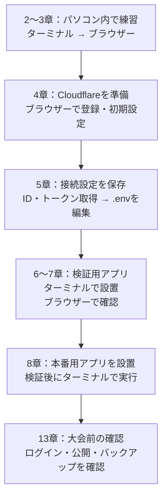

</details>

| 状況 | 読むところ |
| --- | --- |
| 初めてアプリを設置する | [2章](#2-作業に必要なものを用意する)から8章まで順番に進めます。 |
| 運営者を追加する・交代する | [9章](#9-運営者を追加する停止する)。 |
| アプリの新しい版を反映する | [10章](#10-開発者から届いた新しい版へ更新する)。 |
| バックアップを取る | [11章](#11-バックアップを取得する復元できるか確認する)。 |
| エラーやデータの誤りが起きた | [12章](#12-困ったときの確認方法)。 |
| 大会前の確認をする | [13章](#13-大会前に確認する)。 |

## 2. 作業に必要なものを用意する

初回の設置にはパソコンを使います。大会当日の結果入力は、主にスマートフォンで行う想定です。

| 用意するもの | 用途・確認すること |
| --- | --- |
| インターネットにつながるパソコン | 設置とバックアップのコマンドを実行します。 |
| メールを受信できるアドレス | Cloudflareへの登録と、大会アプリの初期管理者に使います。同じアドレスでも構いません。 |
| アプリのファイル一式 | 開発者から受け取ります。`package.json`、`package-lock.json`、`scripts`、`migrations` があることを確認します。 |
| ファイルを編集するソフト | 以下では、現在の作業環境に合わせてVisual Studio Codeを例に説明します。 |
| Node.js 24以上 | パソコンで管理用プログラムを動かすために必要です。次の手順で確認します。 |

### コマンドを入力する場所を開く

コマンドとは、パソコンへ作業を指示する文字列です。本書の `npm` や `node` で始まる行は、ブラウザーやCloudflareの画面ではなく、パソコンの「ターミナル」に入力します。

1. Visual Studio Codeで「ファイル」→「フォルダーを開く」を選びます。
2. アプリの `package.json` が直接入っているフォルダーを開きます。この場所を「アプリのフォルダー」と呼びます。
3. 「ターミナル」→「新しいターミナル」を選びます。ウィンドウの下側に入力欄が開きます。
4. 次を1行ずつ入力し、それぞれEnterキーを押します。

```sh
node --version
npm --version
```

`node` の結果が `v24.0.0` のように表示され、`v` の直後の数字が24以上なら使用できます。`npm` も数字のバージョンを表示することを確認します。`npm` は必要なプログラムをまとめて導入・実行する道具です。

`command not found` などと表示される場合や、Node.jsが24未満の場合は、[Node.js公式ダウンロード](https://nodejs.org/ja/download)から利用するOSに合ったNode.js 24のインストーラーを入手して導入します。導入後はVisual Studio Codeを開き直し、もう一度確認します。

以降のコマンドは、すべてこのアプリのフォルダーで実行します。入力場所が分からなくなったら、ターミナルで次を実行してください。

```sh
pwd
ls package.json
```

`pwd` は作業中のフォルダーを表示します。`ls package.json` でファイル名が表示されれば、その場所に `package.json` があります。見つからない場合は、正しいアプリのフォルダーを開き直します。

本書のコード欄は、中のコマンドだけをコピーします。外側の囲み記号は入力しません。複数行ある場合も1行ずつ実行し、エラーが出たら次へ進まず、12章を確認してください。

## 3. まずパソコンの中だけで動かしてみる

この作業ではインターネット上へアプリを設置せず、手元のパソコンだけで動作を確認します。Cloudflareのアカウントはまだ不要です。

### 手順1：必要なプログラムを導入する

ターミナルで実行します。

```sh
npm ci
```

処理が終わり、次のコマンドを入力できる状態に戻るまで待ちます。`npm ERR!` などのエラーで終了した場合は次へ進みません。

### 手順2：練習用の保存場所を準備する

```sh
npm run db:local
```

このコマンドは、パソコン内の練習用データベースを準備し、開発用の運営者 `dev@localhost` を登録します。「データベース」は、大会情報を保存する場所です。

### 手順3：アプリを起動する

```sh
npm run dev
```

起動したら、ブラウザーのアドレス欄へ次を入力します。

```text
http://127.0.0.1:8787/admin
```

大会一覧が表示されれば、この段階は完了です。「大会を作成」から練習用の大会を作れます。ここではメール認証を省略します。

アプリを動かしている間は、ターミナルが実行中の状態になります。停止するときはそのターミナルを選んで `Ctrl+C` を押します。別のコマンドを実行する場合は、停止するか、新しいターミナルを開いてください。

### 3つの保存場所を区別する

| 本書での呼び名 | コマンド内の表記 | 用途 |
| --- | --- | --- |
| ローカル | `local` | パソコン内での練習。外部の閲覧者はこの画面を開けません。 |
| 検証環境 | `staging` | インターネット上で公開前に動作を試す場所。架空の大会を使います。 |
| 本番環境 | `production` | 実際の大会で使う場所。実データを保存します。 |

それぞれのデータは別に保存します。ローカルや検証環境で作った大会は、本番へ自動で移りません。コマンドに `--remote` とある場合は、Cloudflare上のデータを扱います。以降は操作前に環境名を確認してください。


<details>
<summary>図の編集用Mermaidコード</summary>

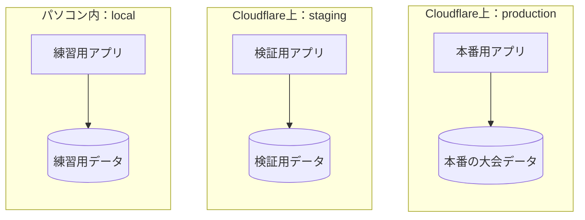

</details>

## 4. Cloudflareのアカウントとログイン機能を準備する

### 手順1：Cloudflareへ登録する

1. ブラウザーで [Cloudflareの登録画面](https://dash.cloudflare.com/sign-up)を開きます。
2. 画面の案内に沿って、管理用のメールアドレスとパスワードで登録します。
3. 確認メールが届いたら、メール内の案内に従ってアドレスを確認します。
4. [Cloudflareの管理画面](https://dash.cloudflare.com/)へログインします。
5. 複数のアカウントが表示される場合は、このアプリを管理するアカウントを選びます。

Cloudflareのログイン情報は、管理担当者が引き継げるよう管理します。2要素認証も設定してください。2要素認証は、パスワードに加えて認証アプリなどで本人確認する設定です。[アカウント準備の公式説明](https://developers.cloudflare.com/cloudflare-one/setup/)

### 手順2：アプリのURLに使う名前を確認する

1. Cloudflareの管理画面で「Workers & Pages」を開きます。
2. アカウントの `workers.dev` 用の名前を確認します。初回に名前の登録を求められた場合は、画面の案内に沿って登録します。
3. 登録後、名前が表示されていることを確認します。

例えば、アカウント側の名前が `tournament-group` の場合、検証用アプリのURLは `https://tournament-board-staging.tournament-group.workers.dev` になります。これは説明用の例で、実際には自分のアカウントの名前を使います。

この方法で始める場合、独自ドメインの購入や、すでに持っているホームページの設定変更は必要ありません。名前の確認場所は[workers.devの公式説明](https://developers.cloudflare.com/workers/configuration/routing/workers-dev/)を参照してください。

### 手順3：Zero Trustを初期設定する

1. Cloudflareの管理画面で「Zero Trust」を開きます。
2. 初回設定画面が出たら、チーム名を入力します。例えば `tournament-team` のような管理用の名前です。
3. プラン選択では、まず「Free」を選ぶ想定です。申込内容を確認して登録します。
4. 支払い情報を求められた場合は、画面に表示された契約内容を確認して入力します。公式手順ではFreeの選択時も支払い情報の登録が必要とされています。
5. Zero Trustの管理画面が開くことを確認します。

チーム名は、運営者の認証に使う組織の名前です。アプリ名や、前の手順で確認した `workers.dev` 用の名前とは別です。運用開始後は、開発者と相談せず変更しないでください。[Zero Trust初期設定の公式手順](https://developers.cloudflare.com/cloudflare-one/setup/)

Workers・D1・Zero Trustには、それぞれ料金や利用上限があります。Freeで開始する方針ですが、すべての利用が無制限に無料になるという意味ではありません。有料プランへの変更は、請求内容を確認して判断します。

画面の日本語・英語表示やメニュー配置は変わることがあります。メニューが見当たらない場合は、管理画面の検索で `Workers & Pages` または `Zero Trust` を探します。

## 5. アプリからCloudflareを操作するための設定を作る

以降の管理用プログラムは、Cloudflareへ「保存場所を作る」「アプリを設置する」といった指示を送ります。そのために、アカウントIDとAPIトークンを用意します。

| 項目 | 意味 |
| --- | --- |
| アカウントID | どのCloudflareアカウントを操作するか指定する番号。ログイン用メールアドレスとは別です。 |
| APIトークン | 管理用プログラムに操作を許可する秘密の文字列。パスワードと同じように扱います。 |

### 手順1：アカウントIDを控える

1. Cloudflareの管理画面で、対象アカウントを選びます。
2. 管理画面の検索を開き、`Copy account ID` を検索します。
3. 検索結果を選び、アカウントIDをコピーします。

「Workers & Pages」の「Account Details」にある「Account ID」からもコピーできます。「Zone ID」は別の番号なので使いません。[アカウントIDの公式確認手順](https://developers.cloudflare.com/fundamentals/account/find-account-and-zone-ids/)

### 手順2：APIトークンを作る

本書では、管理者本人の「User API token」を使う手順を説明します。

1. Cloudflareのプロフィールメニューから「My Profile」→「API Tokens」を開きます。
2. 「Create Token」を押します。
3. 「Custom token」から自分で権限を設定する作成方法を選びます。
4. 名前を `Tournament administration` など、用途が分かるものにします。
5. 次の表にあるアカウント用の権限を追加します。

| 対象 | 権限名 | 操作の種類 | このアプリでの用途 |
| --- | --- | --- | --- |
| Account | Workers Scripts | Edit | アプリの設置と更新。 |
| Account | D1 | Edit | 大会の保存場所の作成、運営者登録、バックアップ取得。 |
| Account | Access: Apps and Policies | Edit | 管理画面のログイン制限を設定。 |
| Account | Access: Organizations, Identity Providers, and Groups | Edit | Zero Trustの設定確認とメール認証の準備。 |
| Account | Access: Service Tokens | Edit | 検証環境の自動テスト用認証を準備。 |
| Account | Account Settings | Read | アカウントの設定情報を参照。 |

6. 「Account Resources」で「Include」→「Specific account」を選び、このアプリを設置するアカウントだけを指定します。
7. 「Continue to summary」で内容を確認し、「Create Token」を押します。
8. 表示されたトークンをコピーします。次の手順で `.env` へ保存します。

`Edit` は変更を許可、`Read` は参照だけを許可する意味です。画面によっては変更権限を `Write` と表記します。上表は現行スクリプトが使う機能に対応する設定で、リモートでの権限の過不足は実行時にも確認します。権限が不足したら、12章に沿ってエラーになった機能を確認してください。

トークンの作成方法と権限名は[APIトークン作成の公式手順](https://developers.cloudflare.com/fundamentals/api/get-started/create-token/)と[権限一覧](https://developers.cloudflare.com/fundamentals/api/reference/permissions/)を参照しています。

トークンの秘密文字列は作成時に控えます。チャットや説明書へ貼り付けたり、運営者へ配布したりしないでください。分からなくなった場合は新しいものを作成して設定し直します。

### 手順3：パソコンの `.env` に保存する

`.env` は、管理用プログラムが設定を読み込むファイルです。名前は先頭がドットの `.env` で、`.env.txt` ではありません。

1. Visual Studio Codeで、アプリのフォルダーにある `.env` を開きます。
2. なければ、同じ場所に `.env` という名前のファイルを作ります。項目の見本は [.env.example](.env.example) にあります。
3. 次の3項目を記入します。すでに値がある場合は、内容を確認して必要な箇所だけ変更します。

```dotenv
CLOUDFLARE_ACCOUNT_ID=コピーしたアカウントID
CLOUDFLARE_API_TOKEN=コピーしたAPIトークン
ADMIN_EMAIL=自分が受信できる初期管理者のメールアドレス
```

4. `=` の右側を実際の値に置き換え、ファイルを保存します。

左側の項目名と `=` は変更しません。`ADMIN_EMAIL` は大会アプリへ最初にログインする人のアドレスです。Cloudflareへの登録アドレスと別でも構いません。

この3行はターミナルへ入力するコマンドではありません。値を設定した `.env` は公開・共有せず、Gitにも追加しません。

## 6. インターネット上に検証用アプリを設置する

ここからはCloudflare上にデータや設定を作成します。まず `staging` の検証環境で試し、本番の実データは入力しません。

「ビルド」はアプリのファイルを配信用にまとめる作業、「デプロイ」はまとめたファイルをCloudflareへ送って動かす作業です。本書ではデプロイを「設置」または「更新」と呼びます。`Wrangler` はその作業に使う道具で、3章の `npm ci` で導入されています。

### 手順1：保存場所とログイン設定を作る

ターミナルで実行します。

```sh
npm run cf:setup -- staging
```

このコマンドが自動で行う内容は次のとおりです。

| 作成・設定するもの | 名前・内容 |
| --- | --- |
| D1の保存場所 | `tournament-board-staging`。 |
| Accessのログイン設定 | 同じく `tournament-board-staging`。 |
| 最初にログインを許可する人 | `.env` の `ADMIN_EMAIL`。 |
| パソコン側の構成ファイル | `wrangler.staging.json`。接続先と認証の設定を保存します。 |

次の表示を確認してから進みます。

```text
D1 tournament-board-staging: 準備済み
Access: 準備済み
構成ファイル: wrangler.staging.json
```

`Access: 初回有効化が必要です` や `Access: 未完了` が出た場合は、ログイン設定が終わっていません。構成ファイルだけが作られる場合もあるため、次の設置へ進まず、4章のZero Trust設定と5章のトークン権限を確認します。

### 手順2：保存するデータの項目を準備する

```sh
npm run wrangler -- d1 migrations apply tournament-board-staging --remote --config wrangler.staging.json
```

これはD1に、大会や運営者を保存するための表を作る処理です。「マイグレーション」は保存場所の構造を作成・更新する処理を意味します。適用内容の確認を求められたら、対象が `tournament-board-staging` であることを確認して進めます。

成功と表示されるか、未適用の変更がないと表示されれば、この手順は完了です。

### 手順3：大会アプリの初期管理者を登録する

以下の `admin@example.com` は説明用です。`.env` の `ADMIN_EMAIL` と同じ実際のメールアドレスに置き換えてから実行します。

```sh
npm run cf:operator -- staging add admin@example.com admin
```

「運営者操作 add: 完了」と表示されたことを確認します。登録内容は次で確認できます。

```sh
npm run cf:operator -- staging list
```

自分のメールアドレス、`"role": "admin"`、`"active": 1` が表示されれば登録できています。`active` は利用できる状態かどうかを表し、1が有効、0が停止中です。

### 手順4：アプリを設置する

次を1行ずつ実行します。

```sh
npm run build
npm run wrangler -- deploy --config wrangler.staging.json
```

終了時に表示された `https://` で始まるアプリのURLを控えます。実際の設置先はその出力を使ってください。例のURLをそのまま使わないようにします。

### 手順5：ブラウザーで動作を確認する

1. 控えたURLの末尾に `/admin` を付け、ブラウザーで開きます。
2. 初期管理者のメールアドレスを入力し、メールに届くワンタイムコードでログインします。
3. 大会一覧で架空の大会を作成します。参加者を2組以上登録し、全員を枠へ配置します。
4. 「下書きを保存」→「公開する」の順で操作します。
5. 「共有画面を開く」で大会の共有URLを控えます。
6. ブラウザーのシークレットウィンドウ、または別の端末で共有URLを開きます。ログインせず閲覧できることを確認します。
7. 大会名や得点を変更して下書き保存し、共有画面は以前の内容を保つことを確認します。再公開後に「最新に更新」で変更が反映されることも確認します。

一般閲覧者へ案内するのは大会ごとの共有URLです。設置先のトップページや `/admin` のURLではありません。

セットアップは `.artifacts` というパソコン内の作業用フォルダーにも設定を保存します。ここには自動テスト用の秘密情報が入る場合があるため、フォルダー全体を公開・共有しないでください。

## 7. Cloudflareの画面で設置状態を確認する

構築後に「どこに何ができたか」を確認すると、問い合わせや更新で対象を取り違えにくくなります。

| 確認するもの | 開く場所・探す名前 | 確認する内容 |
| --- | --- | --- |
| アプリ | 管理画面の「Workers & Pages」から `tournament-board-staging`。 | アプリが存在し、設置先URLを開ける。 |
| 保存場所 | 管理画面で「D1」を検索し、`tournament-board-staging` を選択。 | 同じ環境名のデータベースが存在する。 |
| ログイン制限 | 「Zero Trust」→「Access controls」→「Applications」から `tournament-board-staging`。 | 許可した人と、保護するURLの設定を確認する。 |

Accessのアプリ設定では、対象ホスト名の `/admin` と `/api/admin` を保護します。前者は運営者の画面、後者は保存などの操作を受け付ける窓口です。`/t/…` の共有画面までログイン必須にしないよう、対象を確認します。

「Policy」は誰にログインを許可するかを決めるルールです。対象アプリの「Policies」で `Tournament operators` を探します。作成直後は初期管理者のメールアドレスを許可します。編集場所は[Accessポリシーの公式手順](https://developers.cloudflare.com/cloudflare-one/access-controls/policies/policy-management/)でも確認できます。

## 8. 本番用アプリを設置する

検証用アプリで一通り確認できたら、本番用を別に作ります。本番は次の名前を使用します。

| 項目 | 本番用の名前 |
| --- | --- |
| 環境名 | `production` |
| アプリとD1 | `tournament-board-production` |
| 構成ファイル | `wrangler.production.json` |

### 初回設置の手順

ターミナルで、次を順に実行します。`admin@example.com` は自分の実際のメールアドレスに置き換えます。

```sh
npm run cf:setup -- production
```

「D1」と「Access」の両方が準備済みであることを確認してから、次へ進みます。

```sh
npm run wrangler -- d1 migrations apply tournament-board-production --remote --config wrangler.production.json
```

本番用の保存場所への適用に成功したら、初期管理者を登録します。

```sh
npm run cf:operator -- production add admin@example.com admin
npm run cf:operator -- production list
```

登録状態を確認してから、ビルドして設置します。

```sh
npm run build
npm run wrangler -- deploy --config wrangler.production.json
```

出力された本番URLを控えます。6章の確認を本番URLでも行い、バックアップと復旧の確認が済んでから利用者へ案内します。本番で作ったテスト大会は、確認後に公開を停止してください。現在、大会を削除する画面はありません。

### 独自ドメインを使いたい場合

独自ドメインは、自分で取得するWebアドレスです。例えば `tournament.example.com` のような名前を指します。

このセットアップは `workers.dev` のURLを基準にします。独自ドメインを使う場合は、アプリの接続先とAccessが保護するホスト名の両方を変更する必要があります。アドレスを取得しただけでは完了しないため、開発者へ設定を依頼します。

## 9. 運営者を追加する・停止する

運営者の追加は、次の2か所の設定で完了します。

| 設定する場所 | 何を設定するか |
| --- | --- |
| D1 | 大会アプリを操作できる運営者として登録します。パソコンの管理コマンドで操作します。 |
| Access | メール認証を通過できる人として許可します。Cloudflareの管理画面で操作します。 |

以下は本番環境の例です。`operator@example.com` を追加・停止する本人のメールアドレスに置き換えます。

### 運営者を追加する

アプリ側の登録と、Access側の許可を順に設定します。最後に本人のログインで確認します。


<details>
<summary>図の編集用Mermaidコード</summary>

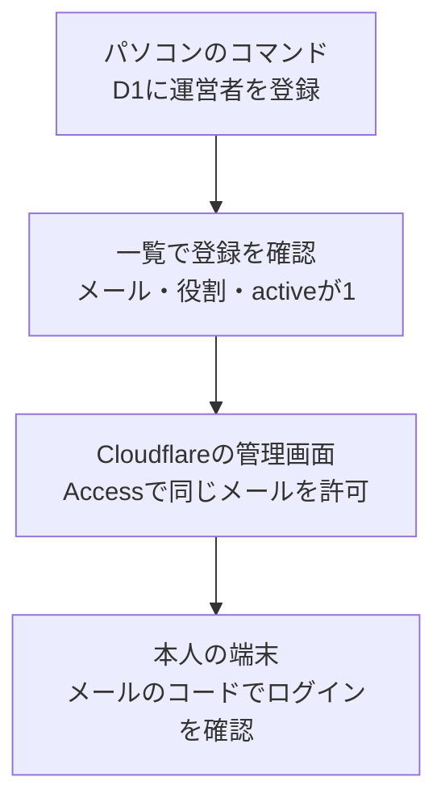

</details>

1. ターミナルで、編集者として登録します。

   ```sh
   npm run cf:operator -- production add operator@example.com editor
   npm run cf:operator -- production list
   ```

2. 一覧で対象者のメールアドレス、`role` が `editor`、`active` が1であることを確認します。
3. ブラウザーでCloudflareの「Zero Trust」→「Access controls」→「Applications」を開きます。
4. 本番用の `tournament-board-production` を選び、設定の「Policies」を開きます。
5. `Tournament operators` を編集します。
6. 「Include」の条件で「Emails」に対象者のメールアドレスを追加します。すでにある運営者のアドレスも残します。
7. 「Save」で保存します。アプリ側にも保存ボタンがある場合は保存します。
8. 対象者へ本番の運営者画面URLと[取扱説明書](取扱説明書.md)を案内し、本人がログインできることを確認します。

`Allow` は許可するという意味です。ルールを「Everyone」にすると全員を対象にするため、特定のメールアドレスを追加する本手順では使用しません。[メール条件と許可ルールの公式説明](https://developers.cloudflare.com/cloudflare-one/access-controls/policies/)

管理コマンドは招待メールを送りません。運営者には初回ログイン時にワンタイムコードが届きます。大会の編集だけを行う人へ、CloudflareのアカウントやAPIトークンを渡す必要はありません。

### 運営者を停止する

停止するときは、先にD1を無効化して管理操作を止め、その後Accessの許可を外します。


<details>
<summary>図の編集用Mermaidコード</summary>

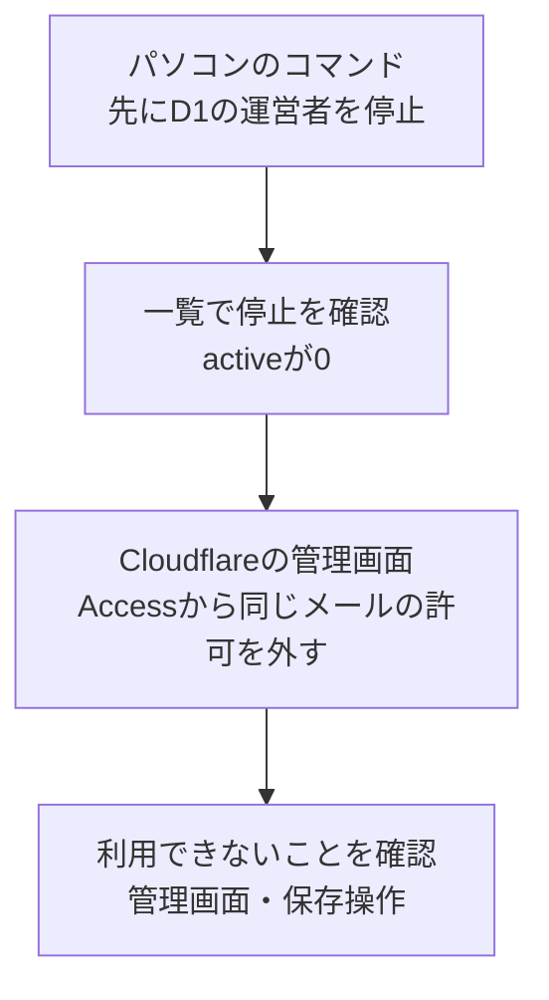

</details>

1. ターミナルで、D1の登録を停止します。

   ```sh
   npm run cf:operator -- production disable operator@example.com
   npm run cf:operator -- production list
   ```

2. 一覧で対象者の `active` が0になったことを確認します。
3. 追加時と同じAccessの `Tournament operators` を開き、「Emails」から対象者のアドレスだけを外して保存します。
4. 対象者が管理画面や保存操作を利用できないことを確認します。

D1を先に停止することで、ログイン済みの人も新たな管理操作ができなくなります。運営者を停止しても、大会データは削除しません。

### アプリの管理者を交代する・利用を再開する

新しい人をアプリの管理者にする場合は、役割を `admin` にして登録します。

```sh
npm run cf:operator -- production add operator@example.com admin
```

既存のアドレスへ `add` を実行すると、役割を変更し、有効な状態へ戻します。停止済みの人を再開する場合も、役割を確認してこの方法で登録し、Access側の許可も戻します。

最後の有効な管理者は停止したり編集者に変えたりできません。先に別の管理者を登録してください。Cloudflareの契約や管理画面の権限を引き継ぐ作業は、このコマンドでは行いません。

## 10. 開発者から届いた新しい版へ更新する

この章は、すでに本番用アプリが動いている場合の手順です。初回設置用の `cf:setup` は通常の更新では実行しません。

1. 更新するファイルと、データベース変更の有無を開発者に確認します。
2. 11章の方法で本番のバックアップを取得し、成功を確認します。
3. 開発者から案内された方法で、アプリのフォルダーを新しい版へ更新します。既存の `.env`、環境別構成ファイル、バックアップと鍵を維持します。
4. 検証環境で先に同じ更新を試します。データベース変更がある場合は、6章の検証用マイグレーションを適用します。
5. 本番のデータベース変更が必要な場合は、開発者が案内した適用順序に従います。新しいコードの設置とDB変更の前後関係を確認してください。
6. 本番の配信用ファイルを作成し、設置します。

```sh
npm run build
npm run wrangler -- deploy --config wrangler.production.json
```

7. 本番の管理者ログイン、大会の保存・公開、共有画面を確認します。

エラーが出た場合は、以前のコードだけを戻して解決すると決めつけず、変更したDBの内容と合わせて開発者へ確認します。コマンドに `production` があると本番へ反映されます。

## 11. バックアップを取得する・復元できるか確認する

バックアップは、大会データなどを別のファイルへ保存しておくことです。日次と、大会前・重要な変更の前後に取得する方針です。

現行コードには、手動で暗号化バックアップを作るプログラムがあります。毎日の自動実行や、パソコン以外への自動保管は別途準備が必要です。Workerの定期処理は古い中間版の整理で、バックアップではありません。

本番から取り出したデータをパソコンで暗号化し、別の場所へ保管します。復元確認ではパソコン内の一時的なD1を使い、本番へは書き戻しません。


<details>
<summary>図の編集用Mermaidコード</summary>

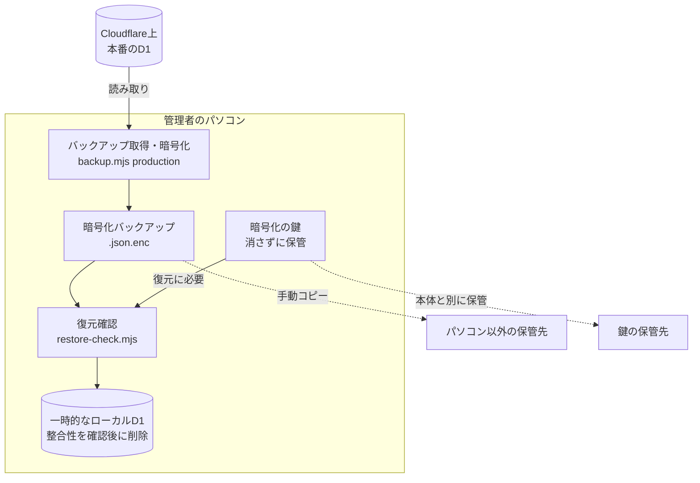

</details>

### 本番のバックアップを作る

ターミナルで実行します。

```sh
node scripts/backup.mjs production
```

成功すると、次のようなメッセージを表示します。日時の部分は実行時刻で変わります。

```text
暗号化バックアップを保存・復号検証しました: .artifacts/backups/production-日時.json.enc
```

このプログラムはD1の内容を取り出し、圧縮・暗号化して保存します。「復号検証」は、暗号化したファイルから元の内容を取り出せることの確認です。本番へ復元済みという意味ではありません。

| パソコンに作られるもの | 用途・扱い方 |
| --- | --- |
| `.artifacts/backups/` 内の `.json.enc` ファイル | 暗号化したバックアップ本体。日付・環境を確認して保管します。 |
| `.artifacts/backup-key` | 暗号化を解くための鍵。通常の初回実行時に自動作成します。削除せず、バックアップ本体とは別に管理します。 |
| `.artifacts/backup-latest.json` | 最後に取得したバックアップの日時・環境・ファイル名などの記録。 |

開発者が `.env` に `BACKUP_ENCRYPTION_KEY` を設定している場合は、その値を鍵として使います。その場合は `.artifacts/backup-key` ではなく、設定した鍵を保管します。どちらの方法か分からない場合は、値をチャットに貼らず開発者へ確認してください。

バックアップと鍵を同じパソコンにしか置かないと、パソコンの故障時に両方を失います。暗号化済みのファイルを管理者だけが使える別の保管先へコピーし、鍵は別に保管します。`.artifacts` 全体には別の秘密情報も入るため、バックアップとしてフォルダー全体を配布しないでください。

### バックアップの中身を読み込めるか試す

作成したファイルを指定し、次を実行します。ファイル名は成功メッセージに表示された実際の名前へ置き換えます。

```sh
node scripts/restore-check.mjs ".artifacts/backups/production-日時.json.enc"
```

この処理は、パソコン内の一時的な保存場所へ復元し、データのつながりを確認します。Cloudflare上の本番DBへは書き戻しません。成功時は `"passed": true` と表示し、結果を `.artifacts/restore-results.json` へ保存します。

この確認だけで、実際の大会の画面表示や、本番復旧の所要時間まで確認できるわけではありません。本番へ戻す訓練は開発者と別に行います。

### 毎日の運用で記録すること

取得日、対象環境、成功・失敗、バックアップの保存先、復元確認の結果を記録します。最後に成功した本番バックアップが24時間以内であることを確認します。

バックアップには参加者名や運営者の情報が含まれます。取扱説明書、公開画面、Gitへ載せません。D1のデータの出し入れは[公式説明](https://developers.cloudflare.com/d1/best-practices/import-export-data/)も参照できます。

## 12. 困ったときの確認方法

### 作業が止まったときの流れ

まずエラーと操作を控え、次の表で確認します。解決できない場合は、控えた内容を開発者へ伝えてください。


<details>
<summary>図の編集用Mermaidコード</summary>

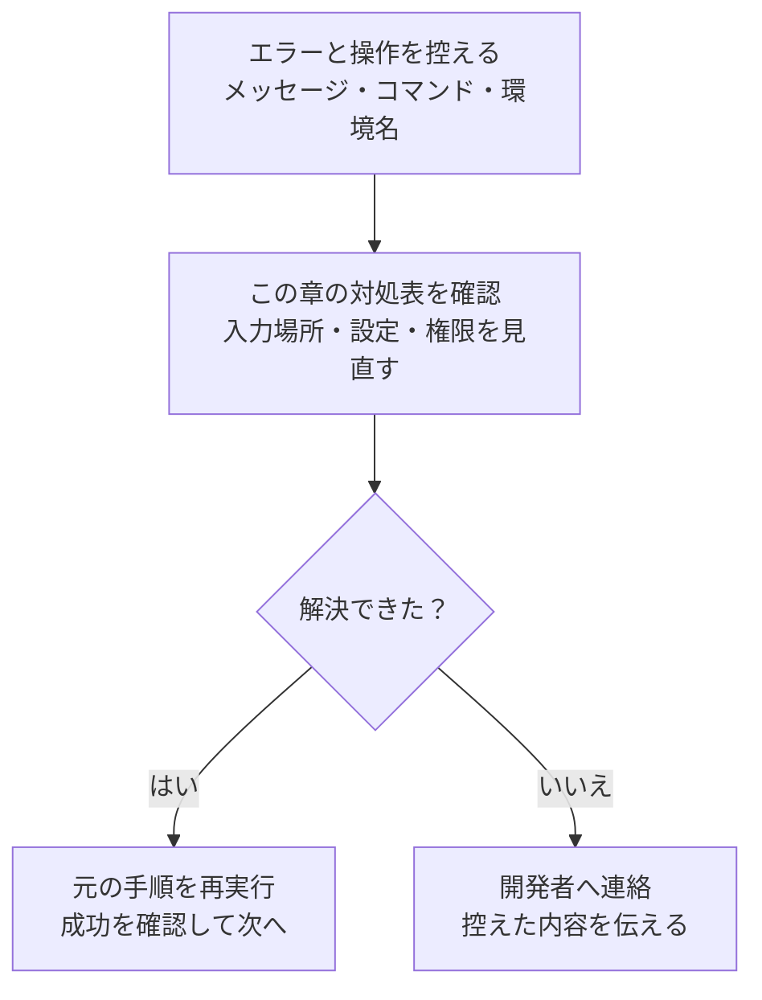

</details>

### エラー別の確認

| 状況・表示 | 確認すること・次の操作 |
| --- | --- |
| `node` や `npm` が見つからない | 2章で導入状況を確認し、Visual Studio Codeを開き直します。 |
| `package.json` が見つからない | アプリのフォルダーを開き直します。 |
| `.env` の設定を求められる | アプリのフォルダーに `.env` があるか、3項目に実際の値を入れて保存したか確認します。 |
| `Cloudflare API 401`、`403` | トークンの有効性、権限、対象アカウントを確認します。番号だけで原因は断定せず、エラーになったコマンドも控えます。 |
| `Access: 初回有効化が必要です` | 4章のZero Trust登録を最後まで終えたか確認します。 |
| `Access: 未完了` | Zero Trustの初期設定とAPIトークンのAccess関連の権限を確認します。解決後、初回設定中の環境について `cf:setup` をやり直します。 |
| `no such table` | 対象環境のマイグレーションを適用したか確認します。 |
| 運営者にコードが届かない | メールの迷惑フォルダーと、Accessの許可リストを確認します。 |
| ログイン後に「運営者として登録されていません」 | `cf:operator ... list` で同じアドレスが有効登録されているか確認します。 |
| 最後の管理者を停止できない | 別の管理者を先に登録します。 |
| バックアップ作成に失敗した | 本番用構成ファイルとトークン権限を確認します。成功メッセージがなければ取得済みと扱いません。 |
| 復元確認に失敗した | バックアップファイルと、取得時に使った鍵を維持して開発者へ連絡します。鍵を新しく作り直さないでください。 |

メール認証では、Accessで許可されているかどうかもコード送信に関係します。コードを何度も要求すると前のコードが使えなくなるため、最新のメールのコードで試します。[ワンタイムコードの動作とトラブル対応](https://developers.cloudflare.com/cloudflare-one/integrations/identity-providers/one-time-pin/)

### アプリが動かない・データを戻したい場合

1. 大会URL、発生した日本時間、行った操作、画面のエラーを控えます。
2. 運営者へ、未保存の入力をメモすることと、復旧作業中は編集を待つことを案内します。
3. 開発者へ状況と最後に成功したバックアップの日時を伝えます。
4. 可能なら現時点のバックアップも取得し、古いバックアップと分けて残します。
5. 書き込みの停止方法、戻す時点、ほかの大会への影響を開発者と確認します。
6. 開発者と検証用の場所で復旧を確認し、本番への反映方法を決めます。
7. 復旧後に、大会内容、公開内容、運営者のログイン、共有URL、PDFを確認します。

D1には過去の時点へ戻す「Time Travel」という機能もあります。ただし、本番DB全体を戻すと、ほかの大会や運営者の登録まで影響を受けます。日時を選んで戻す前に、対象と影響を確認する必要があります。[Time Travelの公式説明](https://developers.cloudflare.com/d1/reference/time-travel/)

アプリには保守中の書き込みを一括停止する画面や、以前の保存版へ戻す画面はありません。11章のパソコン内での復元確認と、本番の復旧は別の作業です。未検証の本番復旧コマンドは本書に掲載せず、停止方法と実行手順を開発者と検証した後に追加します。

復旧の目標は、最大1日前までの巻き戻りと、障害の翌日までの利用再開です。本書の改訂では、その目標を満たす本番復旧の訓練は実施していません。

問い合わせ先は開発者です。連絡方法は別途案内します。エラーの相談時も、APIトークン、ワンタイムコード、暗号化の鍵を送る必要はありません。

## 13. 大会前に確認する

| 確認項目 | 確認する内容 |
| --- | --- |
| 本番URL | 検証環境ではなく、本番のURLを案内している。 |
| 運営者 | 当日の担当者が自分のメールアドレスでログインできる。 |
| 共有画面 | ログインしていない端末で正しい大会を開ける。 |
| 公開の手順 | 下書き保存だけでは共有画面が変わらず、公開後に反映される。 |
| スマートフォン | 入力、「編集」「表を見る」の切替、保存、公開、PDF保存を実機で確認した。 |
| 担当交代 | 保存完了を確認し、次の人が保存版を再読込みしてから編集する。 |
| バックアップ | 24時間以内に成功し、パソコン以外の保管先にも保存している。鍵の保管先も分かる。 |
| 障害対応 | 復旧担当者と、開発者への連絡手段を確認した。 |
| 利用状況・料金 | Cloudflare管理画面のWorkers・D1の利用状況と、契約・請求を確認した。 |

## 14. 管理担当者が控えておくこと

秘密情報そのものを本書へ書かず、管理用の記録へ保存します。

| 項目 | 控える内容 |
| --- | --- |
| Cloudflareの管理 | 管理用メールアドレス、アカウント名、アカウントID。 |
| 設置先 | 本番URL、検証用URL、使用する環境別構成ファイル。 |
| 運営者 | 登録したアドレス、担当、利用停止の状況。 |
| バックアップ | 保存先、取得担当、実行時刻、失敗時の連絡先。 |
| 暗号化の鍵 | 鍵を保管した場所と、引継ぎの方法。 |
| 障害対応 | 開発者への連絡方法、復旧作業の担当者。 |

対応OS・ブラウザー、当日の担当分担、毎日のバックアップ自動実行、保管先、保守中の書き込み停止方法、検証済みの本番復旧手順は未確定です。決定・検証した内容を順次反映します。

## 改訂履歴

| 版 | 日付 | 変更内容 |
| --- | --- | --- |
| 0.3 | 2026年10月26日 | 全体構成、初回準備、環境の区別、運営者の追加・停止、バックアップ、エラー対応に図を追加。SVG画像と編集用Mermaidコードを掲載。 |
| 0.2 | 2026年10月26日 | Cloudflare未経験者向けに全面改訂。用語、アカウント準備、画面操作、入力値、成功確認、本番用コマンド、暗号化バックアップとローカル復元確認を追記。 |
| 0.1 | 2026年10月26日 | 初版。導入、運営者管理、バックアップ、障害対応を記載。 |
